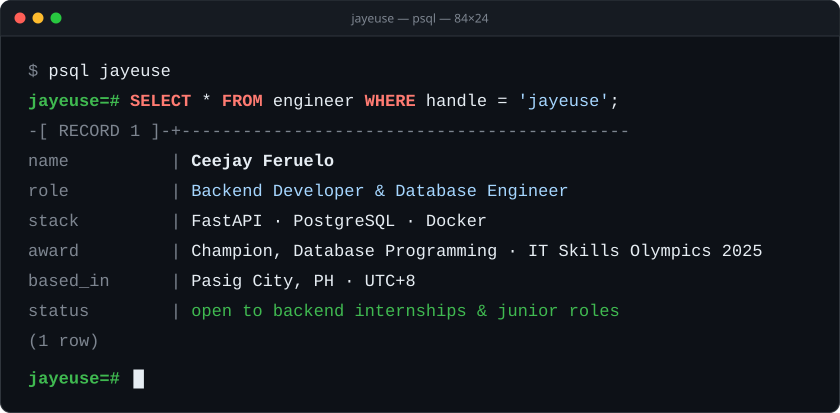
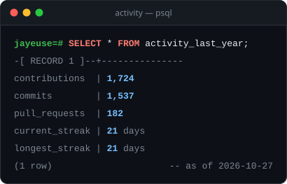
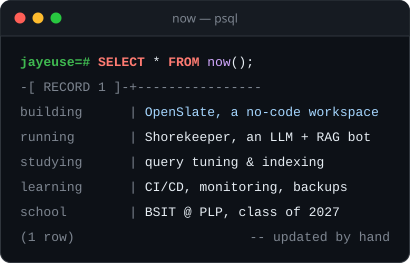

<picture>
  <source media="(prefers-color-scheme: dark)" srcset="assets/hero-dark.svg">
  <source media="(prefers-color-scheme: light)" srcset="assets/hero-light.svg">
  
</picture>

  

Hey, I'm Ceejay, a BSIT student from Pasig who would rather design the schema than the landing page. I build APIs with **FastAPI** on top of **PostgreSQL**, and I care about the parts that keep a system honest after launch: sign-in, role-based access, audit logs, and backups you can actually restore.

Right now that means **[OpenSlate](https://github.com/jayeuse/openslate)**, a self-hosted workspace that lets any organization set up its own internal system without code, and **[Shorekeeper](https://github.com/jayeuse/shorekeeper-bot)**, an LLM bot that answers from real sources with RAG and remembers users in PostgreSQL.

### Stack

<table>
  <tr>
    <td><b>Languages</b></td>
    <td>
      
      
      
      
      
    </td>
  </tr>
  <tr>
    <td><b>Backend</b></td>
    <td>
      
      
      
      
    </td>
  </tr>
  <tr>
    <td><b>Databases</b></td>
    <td>
      
      
      
      
    </td>
  </tr>
  <tr>
    <td><b>Ops &amp; Cloud</b></td>
    <td>
      
      
      
      
      
      
    </td>
  </tr>
</table>

### Activity

<picture>
  <source media="(prefers-color-scheme: dark)" srcset="assets/activity-dark.svg">
  <source media="(prefers-color-scheme: light)" srcset="assets/activity-light.svg">
  
</picture>
<picture>
  <source media="(prefers-color-scheme: dark)" srcset="assets/now-dark.svg">
  <source media="(prefers-color-scheme: light)" srcset="assets/now-light.svg">
  
</picture>

The cards above are SVGs that <a href="scripts/render.py"><code>scripts/render.py</code></a> renders every week from the GitHub GraphQL API.

